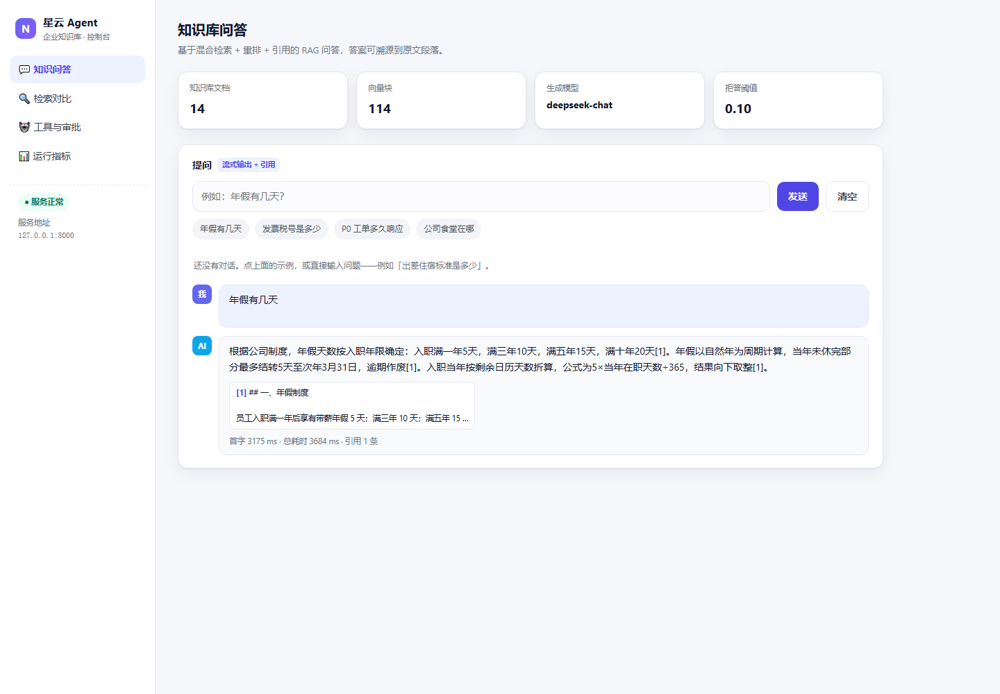
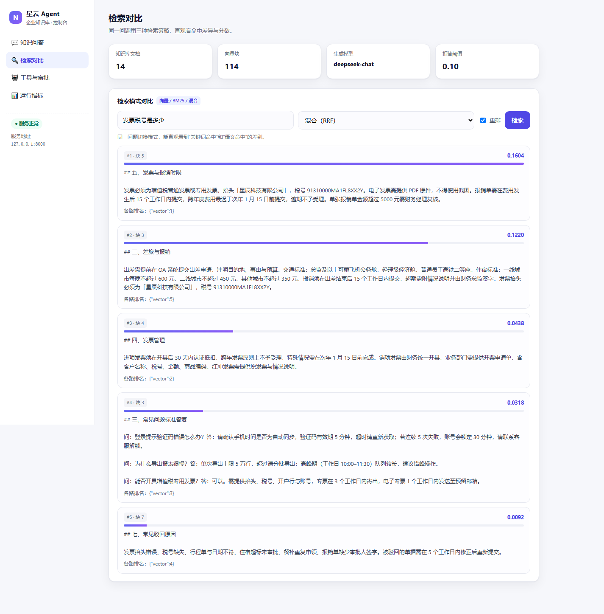
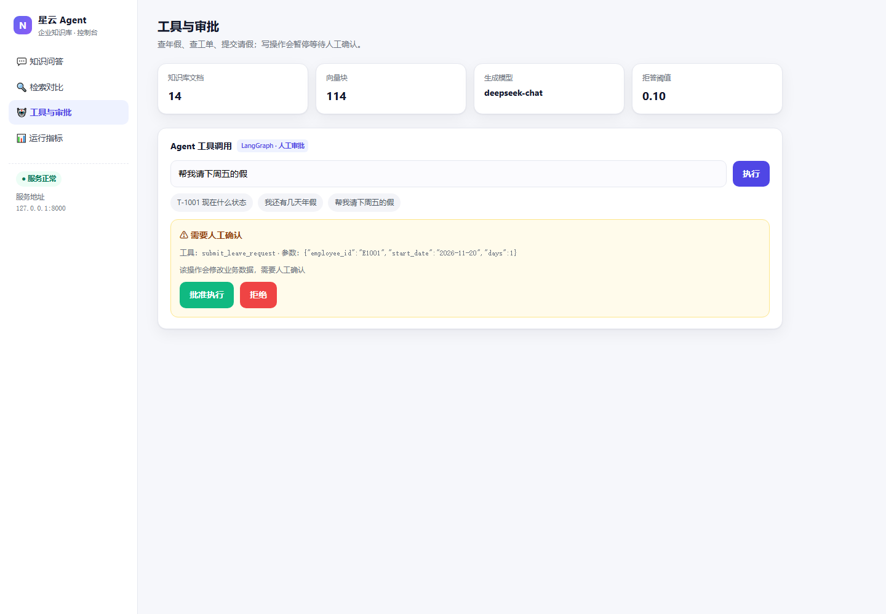
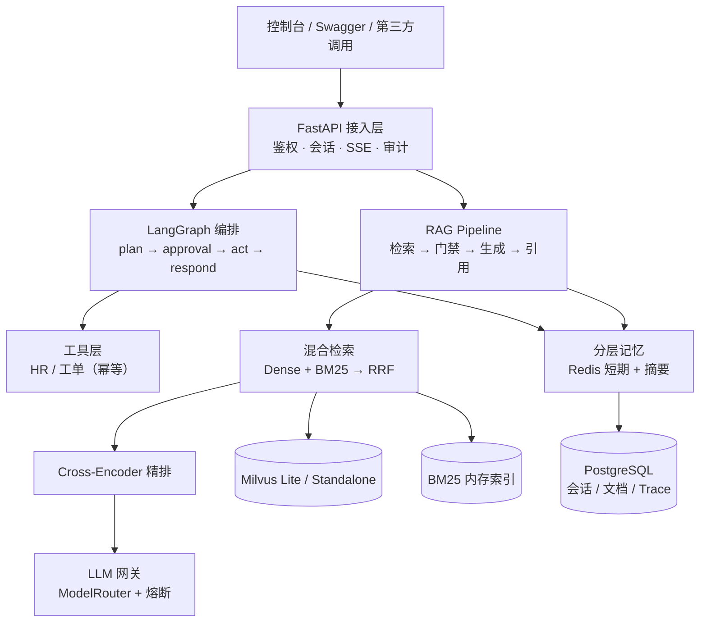

# 企业级 AI Agent 知识库助手

> FastAPI + LangGraph + 混合检索 + 分层记忆，一个能跑起来、有评测数据的企业知识库问答系统。

<p>
  
  
  
  
  
  
  
</p>

**这不是一个"调通就完"的 demo。** 项目从开源骨架出发，补全了向量化、混合检索、重排、引用、拒答、Agent 编排、分层记忆与可观测性，并用 40 题评测集、20 题负样本和并发压测给出了可复现的数字，同时记录了一路踩到的坑（见 [关键决策与踩坑](#关键决策与踩坑)）。

---

## 目录

- [效果预览](#效果预览)
- [能力清单](#能力清单)
- [系统架构](#系统架构)
- [快速开始](#快速开始)
- [配置说明](#配置说明)
- [接口一览](#接口一览)
- [评测结果](#评测结果)
- [关键决策与踩坑](#关键决策与踩坑)
- [目录结构](#目录结构)
- [已知限制](#已知限制)
- [路线图](#路线图)
- [致谢与许可](#致谢与许可)

---

## 效果预览

**知识库问答** — 流式输出，答案自带引用卡片，右下角显示首字延迟与总耗时：



**检索对比** — 同一问题切换向量 / BM25 / 混合，直观看到命中差异与各路排名：



**Agent 工具与审批** — 写操作不放行，弹审批卡片，人工确认后才执行：



---

## 能力清单

| 模块 | 实现要点 | 验证方式 |
|---|---|---|
| 文档 ETL | Markdown 标题感知分块，256 token / 64 重叠，块内保留章节标题 | 14 份文档 → 114 块 |
| 向量化 | bge-m3（1024 维，L2 归一化），GPU 批量推理，模型本地加载 | 检索评测 |
| 向量库 | Milvus Lite 本地文件 / Milvus 服务端共用一套 `MilvusClient` 代码 | 单机跑通 |
| 混合检索 | 向量 Top20 + BM25(jieba) Top20 → **加权 RRF**（1.0 : 0.7） | 40 题四路对比 |
| 精排 | bge-reranker-v2-m3 Cross-Encoder，20 候选 → Top5 | Hit@1 95%，MRR 0.971 |
| 拒答 | 首条重排分 < 0.1 判定证据不足，**不调用大模型** | 域外 20/20 拒答，域内 0 误拒 |
| RAG 对话 | 检索 → 门禁 → 提示 → 生成 → `[n]` 引用解析 | 冒烟 6/6 |
| 流式输出 | SSE：`retrieval → delta → done`，引用先于答案到达 | TTFT 1.2 s（预热后） |
| Agent 编排 | LangGraph 状态机：plan → approval → act → respond | 6 个场景 |
| 工具 | 查年假 / 查工单 / 提交请假（幂等键 + 读写成分离） | 含拒绝、超额失败路径 |
| 分层记忆 | Redis TTL + 滚动摘要 + PostgreSQL 归档 | 20 轮省 80% token |
| 可观测 | Trace 落库、延迟分位、熔断状态、知识库规模 | 13 个接口 |
| 韧性 | 熔断器（5 次失败 → OPEN，60 s 半开） + 启动预热 | 连续失败 0 ms 快速失败 |

---

## 系统架构



**请求链路（一次问答）**

```text
用户提问
  → 意图识别（规则）
  → 混合检索：向量 Top20 + BM25 Top20
  → 加权 RRF 融合
  → Cross-Encoder 精排 Top5
  → 证据门禁：首条重排分 < 0.1 → 直接拒答（不调模型）
  → 组装提示（编号证据 + 最近对话 + 摘要）
  → 流式生成（SSE）
  → 解析 [n] → citations
  → 写入 Redis 短期记忆 + PG 归档 + Trace
```

---

## 快速开始

### 方式一：本地 Python（无需 Docker）

```bash
# 1. 依赖
python -m venv .venv && source .venv/bin/activate
pip install -r requirements.txt

# 2. 模型（约 4.5 GB，国内建议走 ModelScope）
python scripts/download_models.py

# 3. 配置
cp .env.example .env      # 填入 OPENAI_API_KEY

# 4. 中间件（任选其一）
docker compose up -d postgres redis     # 有 Docker
# 或使用本地 PostgreSQL / Redis，改 .env 中的连接串

# 5. 建表并启动
python scripts/init_db.py
uvicorn app.main:app --host 127.0.0.1 --port 8000
```

打开 <http://127.0.0.1:8000/> 即是可视化控制台，`/docs` 为 Swagger。

### 方式二：Docker Compose（一条命令起全栈）

```bash
cp .env.example .env        # 填 OPENAI_API_KEY
docker compose up -d --build
curl http://localhost:8000/api/v1/health
```

Compose 包含 `app / postgres / redis / milvus / etcd / minio`，app 通过 `MILVUS_URI=http://milvus:19530` 连接服务端 Milvus。

> 模型不打进镜像，需把下载好的目录挂载到容器内 `/models`（见 `docker-compose.yml`）。

### 导入示例知识库

```bash
for f in data/*.md; do
  curl -s -X POST http://127.0.0.1:8000/api/v1/documents/upload -F "file=@$f"
done
```

---

## 配置说明

关键变量（完整见 `.env.example`）：

| 变量 | 默认值 | 说明 |
|---|---|---|
| `OPENAI_API_BASE` | `https://api.deepseek.com/v1` | OpenAI 兼容接口地址 |
| `OPENAI_MODEL` | `deepseek-chat` | 生成模型 |
| `EMBEDDING_MODEL_PATH` | `./models/bge-m3` | 向量模型本地路径 |
| `EMBEDDING_DEVICE` | `cuda:0` | 向量模型所在 GPU |
| `RERANK_MODEL_PATH` | `./models/bge-reranker-v2-m3` | 精排模型本地路径 |
| `RERANK_DEVICE` | `cuda:1` | 精排模型所在 GPU |
| `MILVUS_URI` | `./milvus/agent_knowledge.db` | Lite 传本地文件，服务端传 `http://host:19530` |
| `RAG_ENABLED` | `true` | 关闭后退化为直接对话 |
| `RAG_MIN_RERANK_SCORE` | `0.1` | 拒答阈值（用负样本校准，见评测） |
| `RERANK_CANDIDATES` | `20` | 进入精排的候选数 |
| `MEMORY_TTL_SECONDS` | `1800` | 短期记忆过期时间 |
| `MEMORY_SUMMARY_TRIGGER` | `12` | 超过多少条触发摘要压缩 |

---

## 接口一览

| 方法 | 路径 | 说明 |
|---|---|---|
| GET | `/` | 可视化控制台 |
| GET | `/api/v1/health` · `/health/ready` | 存活 / 就绪（含 DB 探活） |
| POST | `/api/v1/documents/upload` | 上传 → 解析 → 分块 → 向量化 |
| GET | `/api/v1/documents` | 文档列表 |
| POST | `/api/v1/search` | 检索（`mode=vector/keyword/hybrid` + `rerank` 开关） |
| POST | `/api/v1/chat` | RAG 对话，返回 `content + citations + refused` |
| POST | `/api/v1/chat/stream` | SSE 流式 RAG |
| POST | `/api/v1/agent/chat` | Agent 对话（工具调用 / 审批挂起） |
| POST | `/api/v1/agent/resume` | 审批后恢复执行 |
| GET | `/api/v1/memory/{cid}` | 会话记忆状态 |
| GET | `/api/v1/trace/{trace_id}` | 链路追踪 |
| GET | `/api/v1/metrics/latency` | 延迟分位与错误率 |
| GET | `/api/v1/metrics/circuit` | 熔断器状态 |
| GET | `/api/v1/metrics/kb` | 知识库规模与关键配置 |

---

## 评测结果

评测脚本在 [`eval/`](eval/) 下，全部可复现。

### 1. 检索效果（40 题：精确 20 + 语义 20，语料 114 块）

| 模式 | Hit@1 | Recall@3 | Recall@5 | MRR |
|---|---|---|---|---|
| 向量检索 | 35/40 | 40/40 | 40/40 | 0.933 |
| BM25 | 33/40 | **36/40** | 40/40 | 0.880 |
| 混合（RRF） | 36/40 | 40/40 | 40/40 | 0.950 |
| **混合 + 重排** | **38/40** | 40/40 | 40/40 | **0.971** |

> 分组结论：精确型问题 BM25 全中，语义型问题向量更稳；**混合检索在两类上都不吃亏，重排再补最后一击**。

### 2. 拒答质量（阈值校准）

| 分组 | 首条重排分 min | 中位数 | max |
|---|---|---|---|
| 域内问题 | 0.160 | 0.966 | 0.998 |
| 域外问题 | 0.000 | 0.006 | 0.064 |

阈值取 0.1（落在 0.064 与 0.160 之间）：**域内误拒 0/20，域外拒答 20/20**。

### 3. 时延（单并发，预热后）

| 指标 | 数值 |
|---|---|
| 检索耗时 | 330–370 ms |
| 首 token（TTFT） | 1.2–1.4 s |
| 完整回答 | 1.7–2.0 s |
| 拒答路径 | 0.31–0.34 s（不调模型） |

### 4. 压测（`/chat` 全链路，单 worker）

| 并发 | QPS | P50 | P95 | 错误 |
|---|---|---|---|---|
| 5 | 2.86 | 1.67 s | 2.70 s | 0 |
| 20 | 3.0–3.8 | 4.8–6.0 s | 8.2–9.5 s | 0 |
| 50 | 3.45 | 11.9 s | 20.0 s | 0 |

> 并发 20→50 时 QPS 不再增长、延迟线性上升 = 系统已饱和。瓶颈是外部 LLM API（约 1.2 s/次）与单 worker；**多 worker 不可行**，因为每个副本独占约 4 GB 显存，2 个即 OOM——正确做法是把 embedding/rerank 拆成独立推理服务。

### 5. 分层记忆（20 轮长对话）

| 轮次 | 提示 token | 全量历史 token | 节省率 |
|---|---|---|---|
| 8 | 490 | 813 | 40% |
| 14 | 687 | 1296 | 47% |
| 20 | 353 | 1810 | **80%** |

---

## 关键决策与踩坑

这一节是项目里最真实的部分——每个问题都花了时间，也都留下了可复用的结论。

| # | 问题 | 结论 |
|---|---|---|
| 1 | 512 token 硬切把两三章揉进一块，检索分彼此接近 | 改**标题感知分块**：按 `##` 切、256 token、块首保留标题；员工手册 4 块 → 11 块 |
| 2 | 标准 RRF（等权、全量融合）反而让 Hit@1 从 13 掉到 11 | 改**加权 RRF（1.0 : 0.7）+ 候选封顶**；"用了 RRF"不等于"调好了 RRF" |
| 3 | 首条重排分 0.0196 与余弦 0.615 看着差 30 倍 | 三种分数不可比（cosine / RRF / logit），**阈值必须按各自刻度分别校准** |
| 4 | 拒答阈值 0.05 是拍脑袋，漏掉 2 条域外问题 | 用 20+20 负样本校准到 **0.1**，误拒 0、拒答 20/20 |
| 5 | 服务重启后第一个请求等 19–20 秒 | 首个请求同步加载两个模型；改 **lifespan 后台预热**，降到 0.33 s |
| 6 | `conversations.id` 是 UUID，字符串 cid 插入失败被 `try/except` 吞掉 | 表面正常、实际一条没归档；改 **uuid5 确定性映射**，并暴露归档失败日志 |
| 7 | 熔断器计数永远是 0 | `_build_router()` 每请求新建实例；改**模块级单例**后才真正触发（3 次失败 → 0 ms 快速失败） |
| 8 | transformers 5.x 要求 torch ≥ 2.6，而驱动只到 CUDA 11.x | 降到 `transformers 4.49` + `sentence-transformers 3.4.1`；`pyarrow` 必须降到 16 以兼容 numpy 1.x |
| 9 | 语料从 34 块扩到 114 块后，BM25 语义题 Recall@3 从 100% 掉到 80% | 之前"关键词也够用"是**语料太小的假象**；指标必须在足够干扰的语料上测 |
| 10 | 多 worker 压测直接 OOM | 每个 worker 独立加载模型（约 4 GB 显存）；**拆分推理服务**才是正路 |

---

## 目录结构

```text
.
├── app/
│   ├── api/routes/          # health / chat / document / search / agent / memory / observability / ui
│   ├── core/
│   │   ├── agent/graph.py   # LangGraph 状态机（工具、重试、人工审批）
│   │   ├── rag/             # 混合检索、精排、RAG 编排、流式生成
│   │   ├── memory/          # Redis 短期记忆 + 摘要 + PG 归档
│   │   └── tools/builtin/   # HR / 工单工具（幂等）
│   ├── infrastructure/      # 模型网关、向量库、缓存、数据库、Trace
│   ├── etl/                 # 解析与分块
│   ├── models/              # Pydantic schema
│   ├── static/              # 控制台单页
│   └── main.py
├── data/                    # 14 份示例知识库文档
├── eval/                    # 评测、压测、验收脚本 + 阶段报告
├── docs/images/             # 截图
├── scripts/                 # 模型下载、建表
├── Dockerfile
├── docker-compose.yml
└── requirements.txt
```

---

## 已知限制

1. **示例语料是合成的**，指标偏乐观；真实企业文档预计低 10–20 个百分点，拒答阈值需重新校准。
2. **Agent 规划是规则 + 正则**，不是 LLM Planner；一次只调一个工具。
3. **LangGraph checkpoint 在内存**，进程重启后挂起的审批会丢；生产应换 `PostgresSaver`。
4. **流式响应没有 usage**（DeepSeek 未支持 `stream_options.include_usage`）。
5. **单 worker** 是当前吞吐上限；多 worker 受显存限制，需要拆分推理服务。
6. Trace 与业务共用 DB session，高并发下应改为异步批量写。

---

## 路线图

- [ ] 拆分 embedding / rerank 推理服务，API 层水平扩容
- [ ] LangGraph 换 `PostgresSaver`，审批状态持久化
- [ ] 支持 PDF 表格与图片 OCR 解析
- [ ] 查询改写（Query Rewrite）+ 多轮指代消解
- [ ] 前端支持会话历史与知识库管理
- [ ] 接入 OpenTelemetry，替换自研 Trace

---

## 致谢与许可

- 项目骨架来自 [bcefghj/ai-agent-interview-guide](https://github.com/bcefghj/ai-agent-interview-guide)（MIT），本仓库在其 `project-python` 基础上补全实现与评测。
- 向量模型 [BAAI/bge-m3](https://huggingface.co/BAAI/bge-m3)、精排模型 [BAAI/bge-reranker-v2-m3](https://huggingface.co/BAAI/bge-reranker-v2-m3)。
- 本项目采用 [MIT License](LICENSE)。
